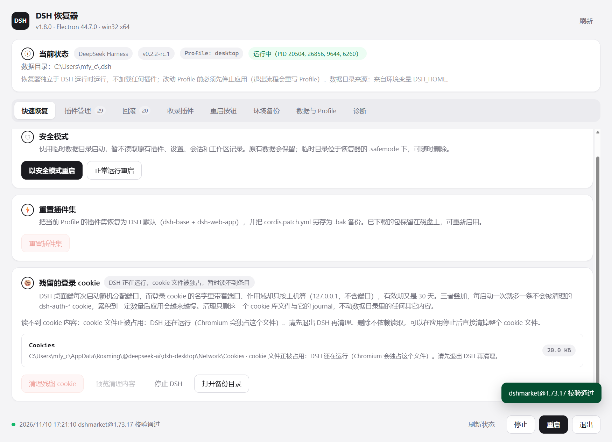
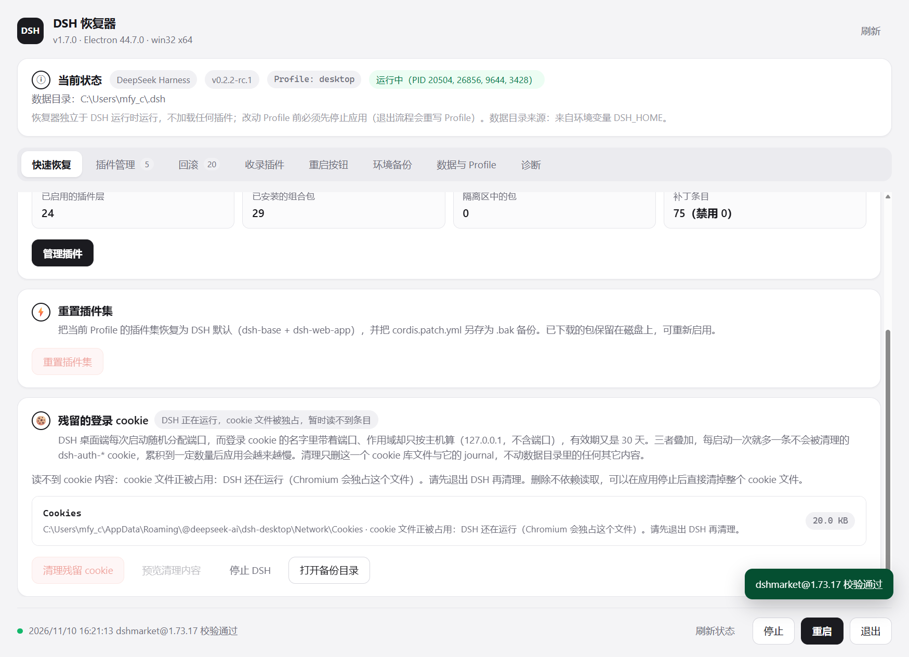
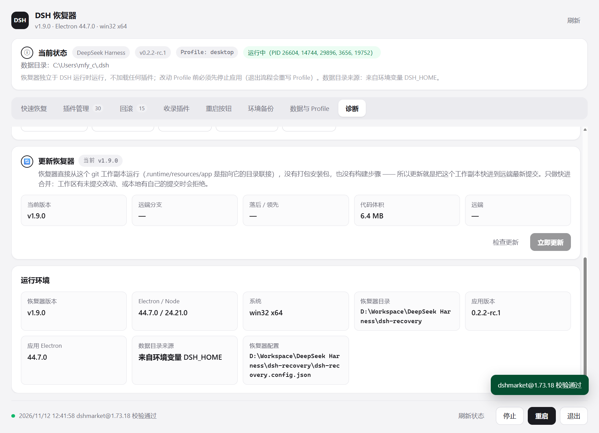
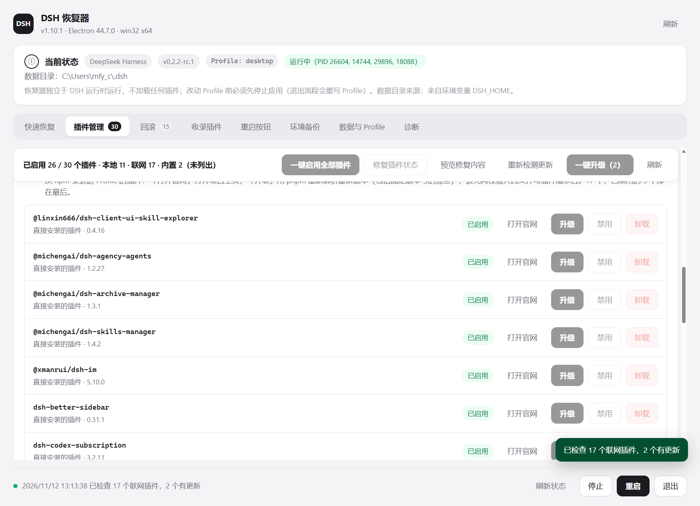
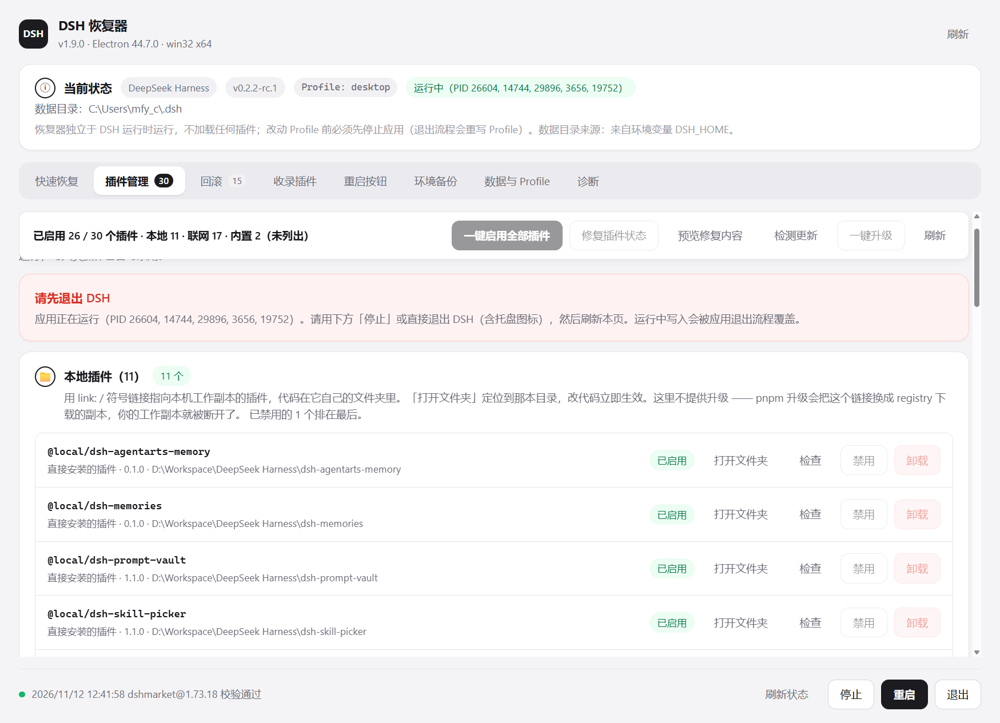
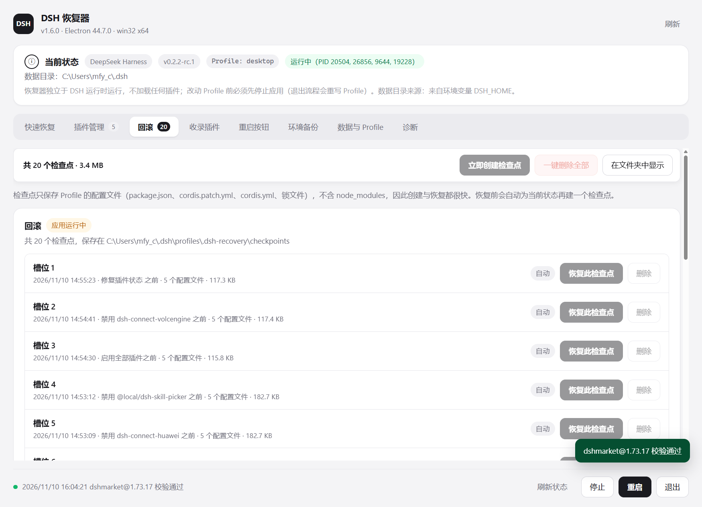
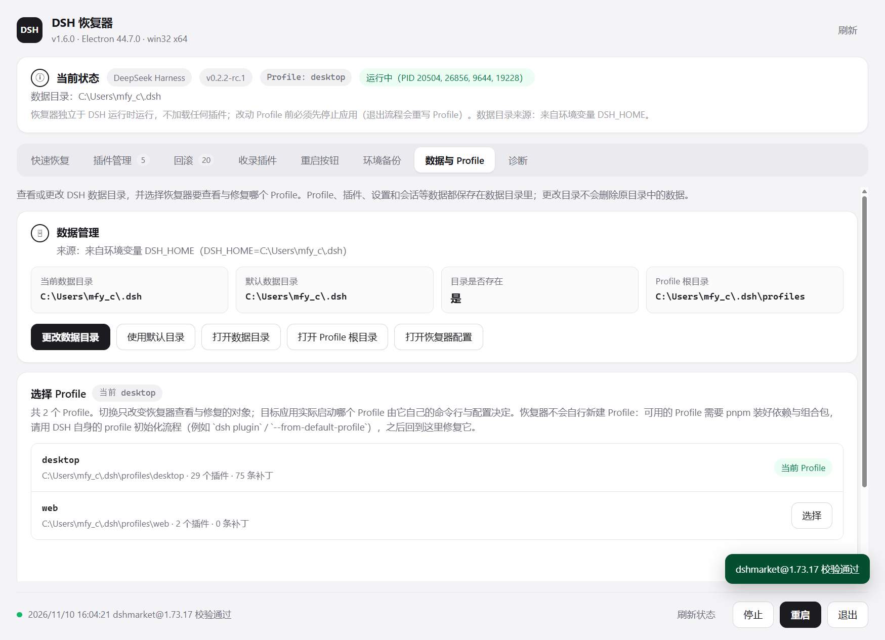
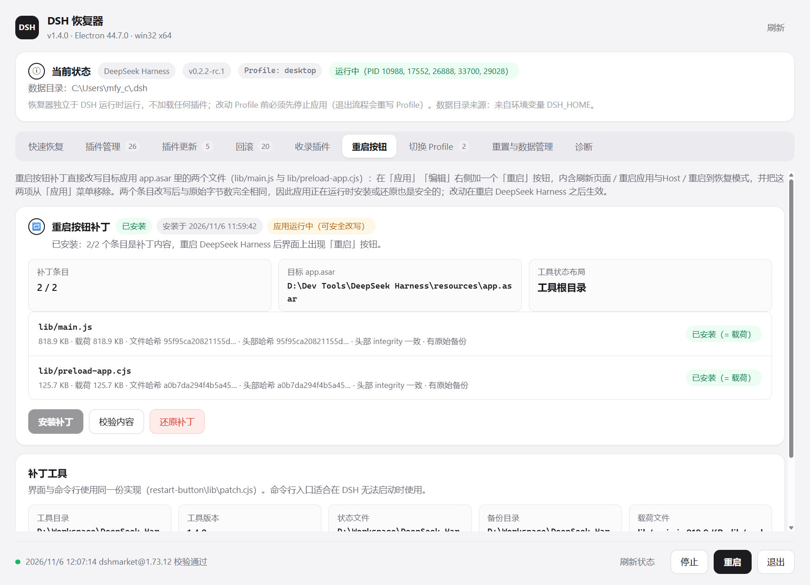
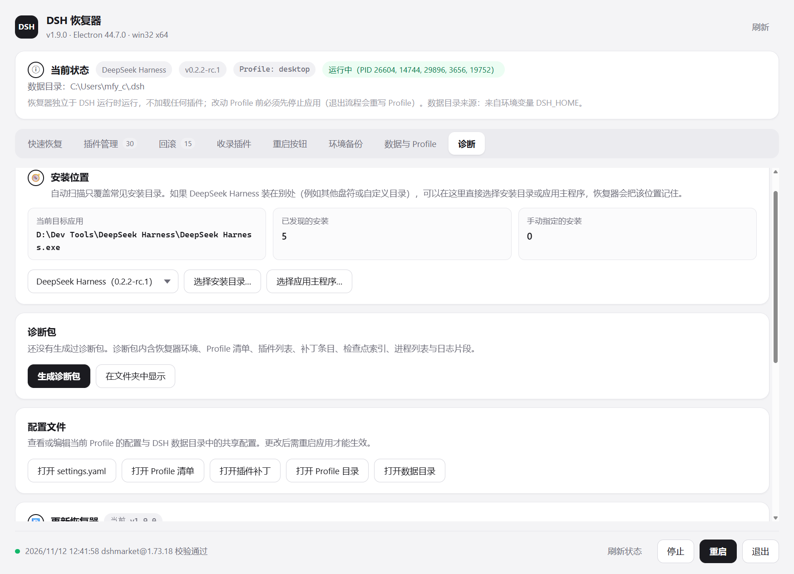
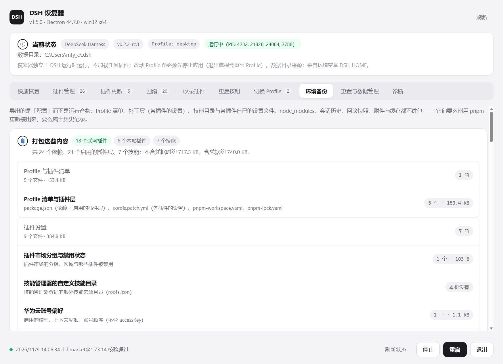

# DSH 恢复器（dsh-recovery）

一个**独立的桌面恢复控制台**，让 DeepSeek Harness 在无法正常启动时仍然可以被修复。
八个标签页：快速恢复 / **插件管理** / 回滚 / **收录插件** / 重启按钮 / **环境备份** / **数据与 Profile** / 诊断。



| 残留的登录 cookie（快速恢复页下方） | 更新恢复器（诊断页） |
| --- | --- |
|  |  |

| 联网插件的行内版本提示（检测更新之后） |
| --- |
|  |

| 插件管理（管理 + 更新） | 回滚 | 数据与 Profile |
| --- | --- | --- |
|  |  |  |

| 重启按钮 | 诊断 | 收录插件 | 环境备份 |
| --- | --- | --- | --- |
|  |  |  |  |

## 为什么不做成 DSH 插件

DSH 插件只有在 DSH（以及它的 Profile）成功启动之后才会被加载。
既然要解决的问题正是「DSH 起不来」，恢复能力就必须位于 DSH **之外**：
本控制台使用自带的 Electron 运行时启动，`require` 的只有 Node 内置模块和 `electron`，
**不加载 DSH 运行时、任何 Profile 组合包或第三方模块**。

它因此是「第二个程序」，而不是「DeepSeek Harness 里的一个页面」。

## 快速开始

```bat
:: 启动（首次会自动准备运行时）
dsh-recovery.cmd

:: 在桌面创建快捷方式（带专属图标）
create-shortcut.cmd                 :: → 桌面「DSH 恢复模式.lnk」
create-shortcut.cmd 我的恢复模式    :: → 自定义名称

:: 只准备 / 刷新运行时（在安装或升级 DeepSeek Harness 之后运行）
setup-runtime.cmd

:: 列出识别到的应用安装目录
setup-runtime.cmd --list

:: 无窗口自检：跑完整的读取链路并打印摘要，全部正常时退出码为 0
.runtime\dsh-recovery.exe --self-check

:: 无窗口端到端自检：在一次性 fixture 上真实执行禁用/卸载/检查点/启动/停止
.runtime\dsh-recovery.exe --verify

:: 无窗口界面自检：真的开一次窗口、点开「重启按钮」页签、断言页签/桥接口/按钮状态并截图
.runtime\dsh-recovery.exe --ui-check              :: 截图默认写 .runtime\ui-restart-tab.png
.runtime\dsh-recovery.exe --ui-check --ui-shot=D:\shot.png
```

> 这三条自检在 PowerShell 里要**先清掉 `ELECTRON_RUN_AS_NODE`**
> （DSH 会把它注入子进程环境，值为 `1` 时 Electron 会以纯 Node 模式启动，
> 把 `--verify` 当成自己的未知开关并报 `bad option: --verify`）：
>
> ```powershell
> Remove-Item Env:\ELECTRON_RUN_AS_NODE -ErrorAction SilentlyContinue
> Start-Process .\.runtime\dsh-recovery.exe -ArgumentList '--verify' `
>   -RedirectStandardOutput verify.json -RedirectStandardError verify.err.txt `
>   -PassThru -Wait -NoNewWindow
> ```
>
> `dsh-recovery.cmd` 已经替你做掉这一步，直接双击运行不受影响。

启动参数（同时会被记住到 `dsh-recovery.config.json`）：

| 参数 | 说明 |
| --- | --- |
| `--target=<目录或 id>` | 目标应用，例如 `--target="D:\Dev Tools\DeepSeek Harness"` 或 `--target=deepseek-harness` |
| `--profile=<名称>` | 要操作的 Profile，默认 `desktop` |
| `--home=<目录>` | DSH 数据目录，默认取环境变量 `DSH_HOME`，否则 `%USERPROFILE%\.dsh` |

## 八个标签页

| 页面 | 能力 |
| --- | --- |
| 快速恢复 | 以**安全模式**启动（临时环境，不读原有插件/设置/会话，退出后自动清理）；正常启动；重置插件集；**清理残留的登录 cookie**（见下文「为什么 DSH 会越用越慢」）。这里只放「一进来就要做的事」：跳转类与打开目录类入口分别收在各自页签与「数据与 Profile」/「诊断」 |
| 插件管理 | **一页管全部插件**。按来源分组（本地插件 / 联网插件；**内置组件只计数、不列出** —— 它们既不能禁用也不能卸载）；每组内**已禁用的排在最后**，启用的先看。每行给出：启用/禁用、打开（本地插件定位到它的工作副本文件夹，联网插件打开项目主页）、**升级**（仅联网插件）、卸载到**隔离区**并可还原；顶部操作条有**一键启用全部插件**（并解除补丁层 `disabled: true`）、**修复插件状态**、**检测更新**（向 npm registry 查询每个联网插件的最新版本，结果**直接标在插件行上**）与**一键升级**（逐个升级有更新的联网插件）。下方卡片：安装/升级插件市场、**安装一个插件**（包名或 GitHub 地址）、不一致的插件、更新前风险、隔离区、「其他依赖」。直接对**已停止的 Profile** 执行 pnpm，用于绕开应用内「更新卡在 remove」与「市场不能更新自己」两个宿主缺陷，详见下文 |
| 回滚 | 列出检查点（槽位）、创建、恢复、删除；**一键删除全部检查点**；每个检查点记录插件清单、组合包列表、补丁和被禁用的行 |
| **收录插件** | 按 [awesome-dsh-plugin](https://github.com/awesome-dsh-plugin/awesome-dsh-plugin) 的 `contributing.md` 逐条核对插件仓库，生成可直接提交的 `data/plugins/<owner>__<repo>.yml`；「必须修正」可**一键复制给 AI 修改**；指定列表克隆后还能查重并写入。**只读**，不需要停止 DSH。规则与流程见 [docs/awesome-plugin-submission.md](docs/awesome-plugin-submission.md) |
| 重启按钮 | 给官方 `app.asar` 安装/校验/还原**「重启」菜单补丁**（菜单栏「应用」「编辑」右侧多一个「重启」，内含刷新页面 / 重启应用与 Host / 重启到恢复模式）；显示两个条目的判定、头部 integrity 与备份状态 |
| **环境备份** | 把「换电脑 / 重装后需要重新配置」的东西打成一个 `.zip`：Profile 清单、补丁层（各插件的设置）、技能目录、各插件自己的设置文件；联网插件记 npm 包名与版本，本地插件记路径 + git remote + 提交。恢复时先预览要改什么，再写回配置、按 remote clone 本地插件、用 pnpm 重装联网插件。**凭据默认不含**，需要时单独导出。详见下文 |
| **数据与 Profile** | 查看/更改 DSH 数据目录、恢复默认；列出可用 Profile（插件数/补丁数）并切换当前 Profile；**恢复出厂设置**（把当前数据目录移入回收站并重启）。Profile 是数据目录的子目录，两件事本来就该在同一屏 |
| 诊断 | **更新恢复器自身**（检查远端并快进合并，只做 ff-only）；「安装位置」卡：**手动选择安装目录或应用主程序**（自动扫描未覆盖时可指定，可切换、可移除）；导出诊断包（日志 + Profile 配置，本地保存、不上传）、在文件夹中显示、打开 `settings.yaml` / Profile 清单 / 插件补丁 / Profile 目录 |

### 环境备份：搬家一次，不用重新配一遍

DSH 的配置散落在数据目录的十几个位置：Profile 的 `package.json` 与 `cordis.patch.yml`、
`~/.dsh/skills` 和 `~/.agents/skills` 下的技能、各插件自己的 JSON、工作区清单、MCP 连接器配置……
换电脑或重装后这些都不在了，而重装插件、重贴 Key、重新调一遍每个插件的设置非常费时间。

这个页签把**配置意图**打成一个 `.zip`，恢复时再把它写回去。


#### 备份什么

| 分组 | 内容 | 为什么值得带上 |
| --- | --- | --- |
| Profile 与插件清单 | `package.json`（依赖 + 启用的插件层）、`cordis.patch.yml`（**每个插件的设置都在这里**）、`cordis.yml`、`pnpm-workspace.yaml`、`pnpm-lock.yaml` | 决定装什么、开什么、各插件怎么配 |
| 插件设置 | 插件市场分组/区域/禁用表、技能管理器的自定义技能目录、华为云账号偏好、免费模型设置、渠道包设置、IM 侧栏与语言 | 这些是插件自己的 JSON，不在 Profile 里，容易被忽略 |
| Agent 与专家 | `agency-expert-personas.json`、`agency-subagents.json`、`agency-subagent-ids.json` | 自定义专家人格与子代理登记 |
| 工作区 | `storages/workspace.json`、`archive_manager_favorites.json` | 工作区路径、标题与排序 |
| 技能 | `~/.dsh/skills/*` 与 `~/.agents/skills/*`，**整个目录**（不止 `SKILL.md`，随附脚本与资料一起走） | 自建技能往往是纯手工产物，丢了最心疼 |
| MCP 连接器 | `storages/mcp_connector.json` | 已连接的服务器、治理策略与工具目录 |
| 凭据（**需单独勾选**） | `.credentials.yaml`、`.dsh-connect-huawei/accounts.json`、`workbuddy-vault/`、`openai-gateway/api-key` | 不勾就要重新登录每家账号 |

#### 不备份什么（页面里逐条列出，不藏）

`node_modules`（能用 pnpm 重新装）、`sessions/`（会话历史）、`rewind-snapshots/`（回滚快照）、
`attachments/`（对话附件）、`cache/`、`dsh-runtimes/`、`storages/session_projcache/`、
IM 的群历史与群文件、`profiles/.dsh-recovery/`（恢复器自己的检查点）、
以及恢复器自己的 `dsh-recovery.config.json`（那是本机设置，换机后本来就该重新指定）。

#### 插件怎么记

- **联网插件**：记 npm 包名与版本（`dshmarket@^1.73.14` 这种）。恢复后按清单跑一次
  `pnpm install`，由 pnpm 装回来；版本写法原样保留，所以 `^` 范围也还在。
- **本地插件**（`link:` 依赖）：源码**不在**包里（它们本来就在你自己的仓库里），
  只记路径 + git remote + 提交 SHA。恢复时目录已存在就直接用，不存在就按 remote
  clone 到原来的路径并切到记录的提交；没有 remote 的会在页面上标成「需要手动放置」。

#### 恢复前会告诉你将要改什么

选一个备份 → 「预览」会读出包内的 `manifest.json` 并逐项对比当前数据目录，
给出 **新增 N / 覆盖 N / 相同 N / 技能 N**、本地插件的可恢复状态、以及包里带了什么。
确认之后：

1. 自动创建**检查点**（可随时从「回滚」页退回去）；
2. 写回配置文件（Profile 清单**最后**写，因为它是下次启动去装插件的依据）；
3. 按 remote clone 缺失的本地插件；
4. 用 pnpm 重装联网插件（失败会明确报出来，配置已经写好了，可以只重试这一步）。

#### 凭据：默认不带，带了就等于密码

默认导出的包里**一个凭据都没有**——连文件名都看不到。需要时才点「导出备份（含凭据）」，
并在确认框里看到明确警告：那个 `.zip` 等同于你的账号密码，不要上传到网盘公开目录或发给别人。

还有一层防护：如果包里的 `manifest.json` 声明 `includesSecrets: false`，恢复时**任何**
凭据类文件都会被跳过并记一条警告。清单说没带、实际却带了凭据的包，不会被写出去。

#### 备份文件也是不可信输入

备份是用户自己放进来的文件，所以恢复时会校验：

- 包内每个文件都对照 `manifest.json` 里的 `sha256`，对不上就跳过（下载损坏不会静默生效）；
- 条目名只接受已知位置：`profiles/<名称>/` 下只允许那五个 Profile 文件（不能借道写 `node_modules`），
  `..` 一律拒绝（不能写到数据目录之外）；
- 不是恢复器生成的包、ZIP64、加密条目、损坏的中央目录，都报明确错误而不是"尽力而为"。

这三条都有断言守着，并**验证过断言有效**：把路径校验和凭据校验分别改坏后，
`--verify` 立刻报「拒绝写到数据目录之外」和「声明不含凭据的包不还原凭据」失败。

#### 备份文件放在哪

`dsh-recovery\backups\`，文件名带时间戳与 Profile 名。这个目录在 `.gitignore` 里——
它是本机配置（可能含凭据）的产物，**不会**被提交，也不该随手分享。


### 手动指定安装位置

自动扫描只覆盖 `%LOCALAPPDATA%`、`%ProgramFiles%`、`D:\Dev Tools` 等常见根目录下的一层子目录。
装在别处（其他盘符、绿色版、自定义目录）时，在**诊断 → 安装位置**里点：

- **选择安装目录…** —— 选应用目录即可，恢复器会读取其中的 `resources\app.asar` 与主程序；
- **选择应用主程序…** —— 直接选那个 `.exe`，会自动反推它所在的安装目录；
- 已有的手动位置可以切换（下拉框）或**移除此手动指定的安装**；自动发现的安装不能被移除。

接受的位置是「包含 `resources\app.asar`（或 `resources\app\package.json`）与主程序的目录」——
传 `resources` 子目录或 exe 路径也能反推回安装目录；不符合时报错并说明需要什么，
不会写入配置。选择结果保存进 `dsh-recovery.config.json` 的 `targets`，下次启动照旧生效。
这三条动作也进了 `--verify`（8 项检查），且用 `persist: false` 在内存里跑，
真实配置文件前后按字节比对不变。

### 插件更新：检测与一键升级

单个插件的「升级」一直都在，但要知道**哪些**该升级，得一个个点。现在有两个按钮：

| 按钮 | 做什么 |
| --- | --- |
| **检测更新** | 向 npm registry 并发查询每个联网插件的 `latest`，与已安装版本比对。**只读**：不建检查点、不需要停止 DSH、不写任何文件 |
| **一键升级** | 把有更新的插件逐个 `pnpm add` 到最新。串行执行（并发 pnpm 会抢同一个 lockfile），**一个失败不中断整批** |

下面三件事是刻意这么做的：

**1. 查不到 ≠ 已是最新。** registry 超时、私有包、或用了不同的 registry 时，
那个包会被单列在「查不到版本的插件」里，**不会**被算进「都是最新版本」。
把失败静默转成「已是最新」是这类功能最容易犯、也最难发现的错。

**2. 本机版本比 registry 还新时不动它。** 只认 `latest` **严格高于**已安装版本。
如果是 `link:` 本地副本、走了 dist-tag、或者是 fork（本机 1.5.0、registry 只有 1.4.0），
「升级」实际上是**降级** —— 这类会被报告出来但不参与升级。

**3. 尊重 Profile 的 `.npmrc`。** 内网镜像上的包版本和 npmjs 不一样，
直接打 npmjs 会把「镜像里齐全的插件」全报成过期。

版本比较按数字而不是字符串：`1.10.0 > 1.9.0`，字符串比较会得到相反结论。
预发布版低于同号正式版（`1.2.0-rc.1 < 1.2.0`），所以装着的正式版不会因为
registry 上只有一个 rc 就被建议「升级」。

### 更新恢复器自身

这个功能有一个前提，说清楚比藏起来好：

**恢复器没有打包安装包。** `.runtime/resources/app` 是指向本仓库 `app/` 的**目录联接**，
`app/renderer` 是纯静态 JS/HTML/CSS、**没有构建步骤**（`package.json` 里只有 `test`）。
所以「更新软件」= **把这个 git 工作副本快进到远端最新提交**，而不是替换某个安装包。

| 情况 | 行为 |
| --- | --- |
| 落后远端 | 「立即更新」可用，执行 `git merge --ff-only origin/<分支>` |
| 已是最新 | 按钮禁用，显示「已经是最新版本」 |
| **工作区有未提交改动** | **拒绝执行**。快进合并会和你本地的修改冲突 |
| 本地有自己的提交 | `--ff-only` 会失败并原样报出 git 的话，不会强行合并或改写历史 |
| 没有 `.git`（拷贝来的 zip） | 明确告知「无法自动更新」，而不是给一个点了就报错的按钮 |
| 连不上远端 | 报为 `offline`，不影响其它功能 —— 恢复器必须离线可用 |

实现要点（`app/backend/self-update.js`）：

- **全部用异步 `spawn`，带超时。** 早先「更新插件把软件卡死」就是 `spawnSync` 阻塞了
  Electron 主进程；同样的错误不能在新功能里再犯一次。
- 比对前先 `git fetch`：拿陈旧的 `origin/main` 比较，会永远显示「已是最新」。
- 远端版本直接从 `origin/main:app/package.json` 读，不检出、不改工作区。
- 只做 `--ff-only`。合并冲突、变基、改写历史都不是一个「更新」按钮该替你决定的事。
- 更新后提示**重启恢复器**：renderer 文件已经在磁盘上，但 Electron 主进程还持有旧模块。

### 为什么 DSH 会越用越慢：残留的登录 cookie

这一节的结论不是猜的，全部来自已发布源码（`@deepseek-ai/dsh-client-connection`）：

```js
// lib/index.js:335
function cookieName(authority) {
  return COOKIE_PREFIX + encodeBase64Url(createHash("sha256").update(authority).digest());
}

// lib/index.js:307 —— authority 来自 Host 头，含端口
function requestAudience(headers, secure) {
  const host = header(headers, "host");
  const url = new URL(`${secure ? "https:" : "http:"}//${host}`);
  return secure ? url.origin : url.host;   // ← url.host 带端口
}

// lib/index.js:348 —— 作用域只有 Path=/，没有端口
const attributes = `${name}=${value}; Max-Age=${...}; Path=/; ...; SameSite=Strict`;

// lib/index.js:1017 —— 默认 30 天
cookieMaxAgeDays: z.natural().min(1).default(30),
```

三个各自都正确的决定叠在一起就成了缺陷：

| 决定 | 单独看 | 合在一起 |
| --- | --- | --- |
| 端口随机分配 | 正确（避免端口冲突） | 每次启动端口都不同 |
| cookie 名 = `sha256(authority)`，含端口 | 看不出问题 | **每换一个端口就多一个 cookie 名** |
| cookie 作用域按主机算（`127.0.0.1`，不含端口）、`Path=/` | 符合 Cookie 规范 | 几百个名字挤在**同一个主机**下 |
| 生命周期 30 天 | 合理 | 一个月内**没有任何东西会删掉旧的** |

于是每启动一次就多一条 `dsh-auth-*`，累积到一定数量后应用会变慢。**它不报错，只是越来越慢** —— 所以这一页给的是数字，不是玄学建议。

#### 这一页做什么

「快速恢复 → 残留的登录 cookie」：

| 元素 | 含义 |
| --- | --- |
| `dsh-auth-*` 条目 | 当前 cookie 库里属于这个缺陷的条目数。个位数无害，上百条就是问题 |
| 其中已过期 / 其它网站的 cookie | 分别统计，因为清理会连带清掉其它站点 —— 这点必须在按钮旁边说清楚 |
| **清理残留 cookie** | 删除 `Network\Cookies` 与 `Network\Cookies-journal`（**删除前自动备份**到 `cookie-backups\`） |
| 预览清理内容 | 只报告会删什么，不写任何东西 |
| 打开备份目录 | 反悔时从备份恢复 |

**为什么必须停止 DSH 才能清理**：Chromium 运行期间对 cookie 库持有独占锁（实测 `EBUSY: resource busy or locked`）。这看起来是限制，其实是保证 —— 应用停止时，库里所有 `dsh-auth-*` 都属于已经消失的端口，所以「全部删掉」不需要猜哪一个还是活的。运行中删除自己的 cookie 会把人踢下线，那条路径根本不该存在。

清理的实际代价：**所有网站**的登录状态都会失效（不只是 DSH），下次启动 DSH 会重新签发一个。所以按钮旁直接写了这条，而不是藏在确认框里。

#### 实现要点

- 读 cookie 用内置 `node:sqlite`（Electron 自带，零依赖）。`expires_utc` 是 Chromium 的 1601 纪元微秒数，**超出 `Number.MAX_SAFE_INTEGER`**，必须当字符串读、用 `BigInt` 解析，否则 `node:sqlite` 直接抛 `Value is too large to be represented as a JavaScript number`（本次开发真的踩到了）。
- 只认 `dsh-auth-` 前缀，其它站点的 cookie 只统计不点名。
- `appData` 可覆盖，`--verify` 因此能在一次性目录里建真 SQLite 库跑完整流程；**覆盖生效时不会再回落到真实 `%APPDATA%`**（早期版本有这个泄漏，会让自检删掉用户真 cookie，已修并加了「不在覆盖目录内就拒绝删除」的二次防线）。
- 备份按文件分别保留：只留最后一个会把空的 `Cookies-journal` 备份下来、把数据库丢掉（同样踩过）。

### 插件管理：管理与更新为什么是同一页

#### 「禁用」不是「不一致」

这一条曾经判错过，值得记下来。早先的规则是：

> 已安装、声明在依赖里、但不在 `dsh.profile.bundles` 里 → **不一致**（「已安装为插件，但不在 dsh.profile.bundles 里（不会加载）」）

而这个 Profile 里 5 条「不一致」全部是这种情况 —— 它们**是被主动禁用的插件**，是完全正常的状态。
把用户自己做的选择当成故障报出来，有两个后果：页面上永远挂着一个处理不完的红色提示；
更糟的是 **「修复插件状态」会把这些插件重新启用**，等于一次「修复」把用户关掉的插件全打开了。

现在：

- **不在插件层 = 禁用**，不再计入「不一致」；
- `修复插件状态` **只会**清理僵死的写入锁/运行记录、删除指向已不存在包的条目；
  **绝不**把已安装但未启用的插件补回 `dsh.profile.bundles`；
- 真正会让组合失败的只有相反方向 —— 在插件层里却没声明 `dsh.bundle` —— 那条仍然报警。

想启用被禁用的插件，用行内的「启用」或「一键启用全部插件」，那是显式动作。

#### 内置组件与排序

- **内置组件不再列出**。它们随应用发布、既不能禁用也不能卸载，而且每个 Profile 永远是同样两个，
  列出来只会把真正要操作的插件挤到屏幕外面。顶部操作条仍显示 `内置 N（未列出）`，
  所以不是悄悄藏起来。
- **每组内已禁用的排在最后**。启用中的插件才是这一页的目的，长列表里先看到它们。


`插件管理` 和 `插件更新` 曾经是两个页签。它们渲染的是**同一份包清单**，只是后端不同
（`profile.listPlugins` 与 `plugin-updater.inspectProfile`），同一件事在两边的字段名也不一样
（`enabled` / `inBundles`、`source` / `origin`），读者得自己在两套视图之间翻译。
现在按包名合并成一张表：身份、分组与「打开」的目标来自 Profile 读取器，
问题诊断与「能不能升级」来自更新器。

DSH Desktop 的应用内更新有两个**宿主侧**缺陷，都定位到了具体代码：

1. **更新卡在 `remove`**。`@deepseek-ai/dsh-plugin-manager` 的 `removeBundle()` 先跑 pnpm
   （几秒就成功、包已被删掉），再调 `configure()` → `hmr.runExclusive()`。那条队列是
   `this.operations = task.catch(() => {})`：**没有超时、没有取消**。队首一旦不结算
   （某个插件 fiber 在 `stopPlanned()` 的 `fiber.await()` 上不返回），后面所有人都永久排队 ——
   包括同一次更新的 `add`、下一次更新、插件页开关、以及市场自己的 `withMutationLock`。
   界面于是停在「正在移除…」，而重启后插件已经没了。
2. **市场不能更新自己**。`dshmarket` 的 `installOrReinstall()` 里有
   `if (SELF_NAMES.has(name)) return { code: 'market-self-update' }`：桌面端 remove 会先把市场
   从运行的组合里摘掉，补装那一步的代码已经不在了。应用内「设置 → 插件」也没有更新入口。

两者共同的规避方式只有一个：**让包变更发生在 DSH 完全退出之后**。这一页就是它的按钮版：

| 动作 | 做的事 |
| --- | --- |
| 修复插件状态 / 预览修复内容 | 清掉 `<profile>/package.json.lock` 与 `.plugin-manager/run.json`（仍被活进程持有的保留）；补回被宿主丢掉的 `dsh.profile.bundles` 条目；删掉指向已不存在包的条目；**绝不删 `@deepseek-ai/*` 自带组件** |
| 安装插件市场 / 升级到最新 | 市场卡片按 `dshmarket` 是否**真的在 `node_modules` 里**决定按钮：没装就显示「安装插件市场」（市场本身就是应用内安装插件的入口，缺了它应用里没有任何安装页面，只能在这里装），已装则显示「升级到最新」。只在 `package.json` 里声明、磁盘上没有的「半装」状态算作没装 —— 点安装正好把它补回去。装完自动加入插件层 |
| 升级 / 安装 / 卸载 | 用安装目录自带的 pnpm 执行 `add`/`remove`（带 `--config.minimum-release-age=0`，否则新版本会被发布等待期挡住；带 `--ignore-scripts`，见下）；装完**补回插件层条目**并校验入口文件 |
| 已安装的插件（**按来源分两组**） | **联网插件**：从 npm 装的包，可「升级」—— pnpm 重新解析最新版本。<br>**本地插件**：用 `link:` / 符号链接指向本机工作副本的，**没有升级按钮**。pnpm 升级会把链接换成 registry 下载的副本，你的工作副本就被断开了；这类行只给「检查」和「打开文件夹」。后端同样拒绝升级 |
| 安装一个插件（支持 GitHub 地址） | 填包名 / `name@1.2.3` / `@scope/name`，或**直接粘贴 GitHub 地址**（`https://github.com/owner/repo`，也认 `github.com/…`、`git@…`、`owner/repo#子目录`、`/tree/<ref>/<sub>`）。GitHub 地址会先读出仓库的 `package.json` 得到包名，**再从 npm 安装那个包**，而不是拉仓库源码（DSH 插件普遍不提交构建产物，源码安装多半会失败）。「预览」只解析、不安装 |
| 检查 | 单包验收：依赖声明、插件层条目、入口文件、补丁文件是否存在 |
| 上次操作卡住了 | 读 `.dsh-market/log.ndjson` 与 `.plugin-manager/logs/*/pnpm.log`：若日志已写 `Done in …s`，就说明卡点在 pnpm 之后的宿主重组 |
| 更新前需要知道的情况 | 跑之前先把会让本次更新变慢/变脆的原因列出来：lockfile 太旧（要做供应链策略校验）、store 与 Profile 不同盘（无法硬链接）、上次留下的锁或运行记录（pnpm 会等一个已不在的进程）。**不是错误，是提示** |

### 更新为什么会「卡死」——两个原因，都已修掉

**1. pnpm 卡住时，整个窗口失去响应（已修）**。旧实现用 `spawnSync` 调 pnpm，
它会阻塞 Electron 的**主进程** —— 而主进程同时负责画窗口和响应 IPC。所以只要 pnpm
慢一步（registry 反复重试、供应链策略校验、某个包的生命周期脚本不退出），界面就
彻底不动了，只能杀进程。

现在 pnpm 在独立的 `app/backend/pnpm-runner.js` 进程里跑，主进程只是等它的一行 JSON，
**画面继续刷新、按钮继续响应**。`--verify` 直接断言这件事：卡住的子进程期间
事件循环必须继续转（`插件更新: 卡住期间主线程没有被冻结`）。

**2. 有些 pnpm 调用真的会永不返回（已修）**。现在每次调用都有预算（默认 6 分钟），
超时就杀掉整棵进程树并报出可读原因，而不是无限等待。判断依据来自本机真实日志：
`operation-Pe9da3` 那次运行在 registry 上一路 `ECONNRESET` / `UND_ERR_CONNECT_TIMEOUT`
重试，最后刷出 `✗ Lockfile failed supply-chain policy check (194 entries in 1m 12s)`。

另外两处同类风险也一并处理：

- `pnpm add` 加 `--ignore-scripts`：不让包的 `postinstall` 以完整用户权限在
  「控制台正在等待」的窗口期里跑任意代码（已实测 `dshmarket` 这类包自带 `lib/` 产物，
  跳过脚本不影响可用性）；
- `perform()` 之前只把 `busy` 当展示用，快速双击可能并发出两个 pnpm 抢同一个
  lockfile，现在**服务端直接拒绝**第二个操作。

安全边界（在 `backend/ipc.js` 里强制，不依赖界面）：

- 应用运行中**禁止写入**，面板顶部直接显示「请先退出 DSH」；
- 每个写入动作前**自动创建检查点**；
- 同一时刻只允许一个插件变更操作；
- 「升级一个没装的包」「空包名」这类前提错误在**建检查点之前**就拒绝；
- 读不到 manifest 的 Profile 不会让整页崩掉，错误作为数据展示。

对应实现：`app/backend/plugin-updater.js`（Engine，零依赖、可离线工作）。
同一套逻辑另有一个命令行版本 `../dsh-plugin-doctor/`，供不想开图形界面的场景使用。

### 两个「一键」操作

两个长列表页面顶部都有一条**常驻操作条**（`.pbar`，随面板滚动吸顶），不必滚到列表末尾：

- **插件管理 → 一键启用全部插件**：把该 Profile 允许加载的组合包一次性写进
  `package.json` 的 `dsh.profile.bundles`（一次落盘）。规则与单行「启用」完全一致：
  核心件必启用；组合包必须同时出现在 `dependencies` 中且声明了 `dsh.bundle.patch`；
  其余包**跳过并逐条说明原因**（例如 `fake-dep: 不是插件组合包`）。
  只列在 `bundles` 里还不够——补丁层写 `disabled: true` 的条目同样不会被加载，所以
  这条动作**还会把 `cordis.patch.yml` 里所有 `disabled: true` 改成 `false`**：只替换
  `disabled:` 这一行的标量，缩进、注释、`config.enabled` 与其它字段逐字节保持不变，
  原文件的换行风格（LF/CRLF）也照原样拼接回去；改写了哪几条会写进结果消息。
  已全部启用且补丁层无禁用时按钮禁用；重复执行不会产生任何写入；执行前自动创建检查点。
- **回滚 → 一键删除全部**：逐个删除槽位（含自动检查点与恢复前快照），被占用的槽位
  **不会中断整批**，而是记录在失败列表里一并汇报；同时显示释放的空间。
  空列表时按钮禁用、重复执行返回「没有可删除的检查点」；只删快照，不动 Profile 当前内容。

两条动作都有确认框（列出受影响的包名 / 槽位数量与占用空间），并各自进了 `--verify` 与 `--ui-check`。

### 「重启按钮」页签

它管理的是**在 DSH 壳本体上加一个「重启」菜单**的补丁（实现与命令行工具在
`restart-button\`，详见 `restart-button\README.md`）：

- 改写目标是当前目标应用的 `resources\app.asar` 里的 `lib/main.js` 与 `lib/preload-app.cjs`；
- 两个条目都做**等长原地改写**（长度与偏移完全不变，只同步头部的 integrity 哈希串），
  因此**应用正在运行时安装或还原都是安全的**，重启 DeepSeek Harness 后生效；
- 页签里的三个按钮 = `安装补丁`（已安装时禁用）/ `校验内容` / `还原补丁`（未安装且无备份时禁用），
  并在「补丁工具」卡里给出工具目录、状态文件、备份目录、载荷文件的路径与打开入口；
- 底部会保留**上一次运行**的日志（安装/还原/校验），便于排查；
- **DSH 更新后按钮消失是机制性的**，不可能永久解决：官方整包替换 `resources\app.asar`，
  归档里没有可挂载外部代码的扩展点。本机已装 `restart-button\guard.cmd` 并把桌面快捷方式
  指向它，于是**每次启动都会自动检查并补装**，不会再出现「更新完按钮就没了」。
  还原成直接启动应用：`node restart-button\restore-shortcut.cjs`。
- **DSH 每次更新都会把补丁冲掉**（整包替换 `app.asar`），所以「重启按钮又没了」多半不是补丁坏，
  而是换了个版本。页签会明确区分三种情况：`已安装` / `未安装（应用更新过，备份属于更新前的版本）` /
  `未知内容`。中间那种只需重新点一次「安装补丁」——它会自动把旧备份归档到
  `backup\stale-<字节数>-<时间戳>\` 并重建，不会拿旧版本的字节冒充可还原的备份。

## 三种自检

| 命令 | 覆盖范围 | 是否改动磁盘 |
| --- | --- | --- |
| `--self-check` | 只读链路：目标探测、Profile 清单与补丁解析、检查点列表、运行状态 | 完全不写 |
| `--verify` | 全部写操作：插件启用/禁用/**一键启用全部（含补丁层 disabled 解除）**/卸载/还原/永久删除、**插件来源分类（本地/联网/内置）与「打开」目标解析**、检查点创建/恢复/删除/**一键删除全部**、**手动指定/移除安装位置**（含无效目录拒绝）、**插件市场缺失/已装的判定与安装**、**重启按钮补丁的安装/还原往返与「应用更新后旧备份不被当作可还原」**、**环境备份导出/预览/恢复到空目录/恶意包拒绝**、**残留 cookie 的识别/预览不写/备份/恢复/运行中拒绝清理**、**自检不真的弹出资源管理器**、**修复不擅自重新启用已禁用的插件**、**版本比较（1.10 > 1.9、rc < 正式版）、scope 包名编码、registry 读 .npmrc、查不到不算最新、一键升级跳过本地/未装且单点失败不中断、自身更新拒绝脏工作区/无 .git 明确报错**、安全模式启动、停止（精确匹配进程）、诊断包导出 | 只写一次性 fixture 与 `.safemode\`，结束前自清理 |
| `--ui-check` | 真开窗口渲染一遍界面：**八个**页签的数量与名称（并断言不再有独立的「插件更新」与「切换 Profile」）、`window.recovery` 桥接口、两个「一键」按钮的存在与禁用态、**诊断页「安装位置」按钮**、**插件行「打开」按钮与来源标签**、**市场卡片按装没装显示「安装插件市场」或「升级到最新」**、**页脚在未运行/运行中两种状态下的按钮组合**（防 `undefined` 文字）、点开「重启按钮」页签后的活动面板与按钮可用性、**「环境备份」页签的两个导出按钮与「不含凭据」措辞**、**「残留的登录 cookie」卡片的存在、「文件被占用时不报条目数」的措辞**、**不渲染「内置组件」分组**、**每组内已禁用的排在最后**（按 DOM 行序断言，不只是看文案）、**「检测更新」被真实点击一次并断言版本箭头（`x.y.z → a.b.c`）渲染在插件行里、不再有独立的「插件更新」卡片、按钮存在且无更新时「一键升级」禁用**、**「更新恢复器」卡片与按钮的存在与禁用态**，并截图（含快速恢复 / 插件管理 / 回滚 / 收录插件 / 环境备份 / 数据与 Profile / 诊断七张附加截图，外加单独滚到视野的残留 cookie 卡片与「更新恢复器」卡片） | 只写截图 |

`--verify`（167 项检查）在每次运行时构造一个合成环境 `\.runtime\verify-<时间戳>\`：
一份假的安装目录（`resources\app\package.json` 声明为 `@deepseek-ai/dsh-desktop`）和一份假的
Profile，然后用**内存里的** `config` 指向它去跑真实动作，因此：

- 不读、不写真实的 DSH 数据目录，也不写 `dsh-recovery.config.json`（前后按字节比对）；
- 唯一被读取的真实文件是官方 `resources\app.asar`：运行前后各算一次 sha256 并断言相等，
  以此证明所有动作都没有碰过官方安装目录（读取必须绕过 Electron 的 asar 补丁，见 `app/backend/asar.js`）；
- 结束时校验「退出」这一路真的终止了进程（4 秒内未退出即判失败）；
- fixture、临时安全模式目录、以及本次导出的诊断包都会被删除。

任一项失败时退出码非 0，并打印每条检查的 `ok`/`detail`。

## 安全设计

- **应用运行中拒绝一切 Profile 改动**：目标应用退出时会重写 Profile，此时改动会被覆盖。
  控制台检测所有 `DeepSeek Harness.exe` 进程，只把不含 `--type=` 的那个当作主进程展示。
- **卸载 = 移入隔离区**（`profiles\<名称>\.dsh-recovery\removed\<时间戳>-<包名>`），可以还原或永久删除。
- **改 Profile 之前自动创建检查点**，检查点位于 `profiles\.dsh-recovery\checkpoints\<id>`。
- 写入使用临时文件 + 原子替换；配置损坏时回退到默认值而不会让控制台失效。
- 卸载 DSH 插件前校验它是组合包（`dsh.bundle.patch`）且确实在 Profile 依赖中，避免误删。
- **环境备份默认不含凭据**：`.credentials.yaml`、登录令牌、accessKey 只有在你明确点
  「导出备份（含凭据）」时才进包，且确认框会写明「等同于账号密码」。
- **备份文件按不可信输入处理**：逐文件核对清单 `sha256`、条目路径不接受 `..` 与
  `node_modules`、声明不含凭据的包拒绝还原任何凭据。`--verify` 有 5 项断言守着，
  并且验证过断言确实能抓到回归。

## 目录结构

```
dsh-recovery/
  dsh-recovery.cmd        启动器（缺运行时先调 setup-runtime.cmd）
  create-shortcut.cmd     在桌面创建带图标的快捷方式（可传自定义名称）
  setup-runtime.cmd       准备运行时的包装脚本
  setup-runtime.js        从已安装的 DeepSeek Harness 硬链接出 Electron 运行时
  app/
    main.js               Electron 主进程（窗口、IPC 注册、--self-check / --verify / --ui-check）
    assets/               图标：icon.png（1024px，窗口用）+ icon.ico（16–256px 多尺寸，快捷方式用）
    preload.js            contextBridge：暴露 window.recovery.*
    backend/              零依赖后端（paths/profile/checkpoints/diagnostics/zip/launcher/asar/ipc/util/verify/restart-button/backup/cookies/registry/self-update）
    renderer/             原生 DOM 渲染界面（index.html / app.js / styles.css）
  tools/
    make-icon.py          重新生成 app/assets 下的 icon.png / icon.ico（Pillow）
  restart-button/         重启按钮补丁：lib/（asar + patch 库 + 载荷生成 + 命令行）、payload/、backup/、*.cmd
  .runtime/               生成的 Electron 运行时 + resources/app 目录联接 + userdata
                          以及 --ui-check 的截图（ui-restart-tab*.png，docs/ 里的图即由此导出）
  docs/                   README 用的界面截图
  diagnostics/            导出的诊断包（按需创建）
  backups/                环境备份的 .zip（按需创建，已在 .gitignore 中）
  cookie-backups/         清理残留 cookie 前留的原文件副本（按需创建，含登录凭据，已忽略）
  dsh-recovery.config.json 记住的目标/Profile/数据目录
```

### 运行时是怎么来的

`setup-runtime.js` 把已安装应用目录里的 Electron 运行时（exe / dll / pak / locales）
**硬链接**到 `.runtime\`，再把 `.runtime\resources\app` 做成指向本仓库 `app\` 的**目录联接**。
不复制 200 MB 可执行文件，也不改动原安装目录。
因为硬链接共享内容，安装目录升级后重跑一次 `setup-runtime.cmd` 即可。

> 注意：`.runtime\resources\app` 是目录联接，**不要**用递归删除清理 `.runtime`
> （会顺着联接删掉 `app\`）。`setup-runtime.js` 自身只用「删单个文件 + `rmdir` 删联接点」。

## 已知限制

- 目前只在 Windows 上实现（进程枚举/停止用 PowerShell，目录联接用 junction）。
- 「新建 Profile」只提示由 DSH 自身初始化，不在控制台里代建。
- 诊断包导出的是日志与配置快照，不含崩溃内存转储。
- 控制台不加载 DSH 运行时，因此看不到插件加载的实时原因（那部分原因在应用日志里）。
- 自动扫描只找常见根目录下的一层子目录；装在别处需要用**诊断 → 安装位置**手动指定（见上）。

## 版本记录

### 2026-11-14 · v1.10.4 · 适配 DSH 0.2.2-rc.3、启动守卫、修「升级后仍显示可升级」

- 版本号 `1.10.3` → `1.10.4`。适配 **0.2.2-rc.3**（`app.asar` 209021953 B）。上游这次
  只改了一行版本字符串，编辑表无需任何改动，重建即通过。
- **永久办法：没有；自动恢复：有。** 官方更新整包替换 `resources\app.asar`，而归档里没有
  可挂载外部代码的扩展点，所以补丁不可能在更新后存活。新增 `restart-button\guard.cmd`
  作为启动守卫，并把桌面快捷方式指向它：每次启动先只读 `verify`，补丁不在就自动重装再启动。
  三条约束——已在运行不重复启动、补丁失败不阻止启动、不依赖 PATH（用应用自带 node）。
  `restore-shortcut.cjs` 可把快捷方式还原成直接启动应用。
- **修「插件升级成功后仍显示可升级」**：根因是 `lastPluginVersions` 缓存从不失效。
  升级改了磁盘上的版本，缓存里还是旧的 `latest`，于是渲染出 `0.4.18 → 0.4.18 · 有新版本`，
  「一键升级（12）」也照旧数着已经升完的插件。三处一起改：
  - `refresh()` 丢弃缓存；`pluginVersionsSummary()` 读时按**当前已装版本**重算 `outdated`，
    即使某条路径忘了清缓存也不会再误报；
  - 渲染层加 `isNewerVersion()` 兜底，`latest` 不高于已装版本就不显示箭头与标记；
  - 升级完成后自动重扫一次，让面板直接显示「都是最新版本」而不是「还没检查」。
- **修「一键升级」的危险回退**：`outdated` 为空时，旧代码会回退到「所有联网插件」，
  等于点一下就重装全部插件。现在为空直接提示，不做任何安装。
- **修备份归属判据**：`0.2.2-rc.2 → rc.3` 只改版本字符串，两个构建的 `lib/main.js`
  **长度完全相同**（848505）。v1.10.3 只比长度，会把 rc.2 的旧备份认成「与当前一致」，
  此时「还原」会把 rc.2 写进 rc.3 的归档。改用归档的 `dshBuildCommit` 判定归属；
  旧备份没有该字段时从字节里扫版本串来认。
- **修备份里装载荷**：`apply` 原先用「当前条目内容」当备份，条目已打补丁时就等于把载荷存成备份，
  「还原」于是把载荷覆盖载荷——菜单永远回不来但状态显示「已还原」。现在条目已是载荷且无可用
  备份时明确报 `unavailable`，不再伪造。备份修复也不再挂在「这次是否写入」之下。
- `--verify` 146 → **167 项**：新增等长不同构建的备份不被当作可还原、重复安装不把载荷写进备份、
  已打补丁且无备份时不伪造备份、`refresh()` 让版本缓存失效。
- `--ui-check` 的「检测更新」等待从固定 6 秒改为**轮询到按钮不再显示「正在检查…」**（上限 45 秒）：
  固定等待在冷缓存时会假报「没有出现版本箭头」，看起来像代码 bug 其实是测试不稳。

### 2026-11-13 · v1.10.3 · 重启按钮回来了：适配 DSH 0.2.2-rc.2，并修好「更新后备份还在却不能用」

- 版本号 `1.10.2` → `1.10.3`。**「重启按钮」消失的直接原因**：DSH 从 0.2.2-rc.1 升到
  **0.2.2-rc.2**，`app.asar` 被整体替换（213202918 → 208137981 B），补丁改写的两个条目
  回到官方内容。已重新解包、重建载荷、重装补丁：`main.js` 848505 B、`preload-app.cjs` 140570 B。
- 上游这次只改了一处锚点：`DesktopHostProcess` 的 `primaryRuntime` 说明从
  「missing sibling `office-skills` resources fail Host startup」换成
  「the Host exposes it to its profile as `DSH_PRIMARY_RUNTIME`」。编辑表补了第三个候选，
  `pickCandidate()` 仍然只在「恰好命中一次」时动手。
- **顺带修掉一个更难发现的假象**：更新后旧备份文件还在磁盘上，于是 `status` 一路写着
  「有原始备份」，可它是**上一个版本**的字节，长度和当前条目不同，`revert` 的长度校验必然中止。
  也就是说用户以为能回滚，直到真要回滚的那一刻才知道不能。三处一起改了：
  - 判定新增 `stale`：「未安装（应用更新过，备份属于更新前的版本）」，不再含糊地报「未知内容」；
  - `apply` 发现备份长度不符时先把旧备份归档到 `backup/stale-<字节数>-<时间戳>/`
    （**保留不删**，那是那个版本唯一的原始副本），再用当前字节建新备份；
  - `revert` 遇到长度不符时直说「这不是补丁装坏了，而是应用更新过，重新 apply 会归档旧备份」。
- **补上了漏测**：重启按钮补丁一直没被 `--verify` 覆盖 —— 这正是它能悄悄失效两天的原因。
  现在用一个**合成的小型 `app.asar`**（480 B，不碰 208 MB 官方包）跑完整链路：
  安装 → 还原 → 模拟应用更新 → 重新安装 → 再还原，并断言旧备份被归档且长度与当前一致。
  `--verify` 由 146 项增至 **161 项**。
- 过程中顺带修正两处自己的错误：合成归档的 pickle 头部 `headerBufSize` 该是
  `json + pad + 8`（写成 `+4` 会让所有偏移错 4 字节，回读时报「头部 JSON 解析失败」）；
  `apply` 内部回读没把 `payloadDir` 传下去，导致合成测试拿真载荷去比对。

### 2026-11-12 · v1.10.2 · 可升级信息并入插件行，不再单独一张卡片

- 版本号 `1.10.1` → `1.10.2`。按反馈改布局：**删掉「插件更新」那张独立卡片**，
  版本跳转直接显示在联网插件行里 —— 插件名下面那行从 `0.5.32` 变成
  `0.5.32 → 0.5.34 · 有新版本`，右侧再加一个 `可升级 +0.5.34` 标记。
  查看一个插件时不用再去另一张卡片里找同一个包名。
- 仍然保留的只有一种独立卡片：**registry 查不到版本的包**。那类信息属于
  「本次检查不可信」的警告，塞进任何一行都会误导（那些行看起来正常，
  实际是没查到）。它们照旧单列，并且明确写着「没有算作已是最新」。
- 扫描完成后用一条 toast 交代总数（「已检查 17 个联网插件，2 个有更新」），
  替代原来卡片里的那句话。
- `--ui-check` 断言跟着改：不再断言卡片存在，改为按 **DOM 行**统计
  `x.y.z → a.b.c` 的箭头数与 `可升级` 标记数（`inlineJumps` / `upgradeBadges`），
  并新增反向断言 —— 如果又出现以「插件更新」开头的卡片却没有行内箭头就直接报错。
  另外增加了「联网插件」分组的滚动截图（`docs/registry-rows.png`）。

### 2026-11-12 · v1.10.1 · 修「检测更新」把页面打空（row is not a function）

- 版本号 `1.10.0` → `1.10.1`。**修 bug**：点「检测更新」后页面内容全没了，
  右下角弹 `row is not a function`。
- 原因是一处**变量遮蔽**：`outdated.map((row) => row({ ... }))` 里回调参数叫 `row`，
  把模块级的行构建函数 `row()` 遮住了 —— 于是 `row({...})` 变成「调用一个普通对象」。
  扫描本身成功了，是**渲染结果**时抛错把整个面板打空。
- 现在回调参数改名 `entry`，并且顺手把另一处 `.filter((row) => …)` 也改了名：
  那处只是读属性、不会出错，但留着同样的名字迟早有人照着写成遮蔽版本。
- **同时补上了漏测**：`--ui-check` 以前只断言「检测更新」按钮存在，从没真的点过它，
  所以这个 bug 一路漏到用户手上。现在会真实点击一次，并断言
  ① 没有渲染异常 ② 页脚还在 ③ 面板卡片数不为 0 ④ 出现「已检查 N 个联网插件」。
  第 ④ 条是关键：只检查「没崩」会让「点了没反应」也算通过。
- 断言有效性已验证：把 `row` 遮蔽改回去，自检立刻报
  「插件面板没有任何卡片（页面被清空）」等 6 条，正是现象复现；还原后回到 0 issues。
- 顺带：`--ui-check` 的插件面板文本不再截断到 400 字符（之前截断导致无法断言结果内容）。

### 2026-11-12 · v1.10.0 · 恢复器自更新 + 插件更新检测 + 一键升级

- 版本号 `1.9.0` → `1.10.0`。新增三个能力，两个在插件管理、一个在诊断页。
- **插件「检测更新」**（`app/backend/registry.js`）：向 npm registry 并发查询每个联网插件的
  `latest`，与已安装版本比对，只读。三个刻意的设计：查不到版本的包**单列**、不计入
  「已是最新」（把失败静默成"最新"是这类功能最容易犯的错）；只认 `latest` **严格高于**
  已安装版本（本机比 registry 新时不建议"升级"，那是降级）；尊重 Profile 的 `.npmrc` registry
  （否则内网镜像上的包会被整片误报过期）。版本比较按数字：`1.10.0 > 1.9.0`，
  且预发布版低于同号正式版。
- **「一键升级」**（`plugin-updater.updateMany`）：把有更新的联网插件逐个 `pnpm add`。
  **串行**（并发 pnpm 抢同一个 lockfile），**一个失败不中断整批**，本地插件与未安装的包
  逐个跳过并给出原因，最后汇总「N 个已升级 / M 个本来最新 / K 个跳过 / J 个失败」。
- **「更新恢复器」**（`app/backend/self-update.js`）：恢复器没有安装包 ——
  `.runtime/resources/app` 是指向本仓库 `app/` 的目录联接，renderer 是静态文件、无构建步骤，
  所以更新 = 把 git 工作副本**快进**到远端。只做 `merge --ff-only`：
  工作区有未提交改动时**拒绝执行**，本地有自己的提交时不合并、原样报出 git 的话。
  没有 `.git` 的副本明确告知不能自动更新。全部用**异步 spawn + 超时**
  —— 早先「更新插件把软件卡死」就是 `spawnSync` 阻塞主进程，不能再犯。
- 修了一个一直存在的自检卫生问题：`--verify` 的 fixture 里有 git 仓库，
  而 git 的 `.git/objects/**` 是**只读**文件，Windows 下 `fs.rm` 删不掉
  （`force: true` 只抑制 ENOENT，不抑制 EPERM），于是每次自检都在
  `.runtime/` 留下一个 `verify-<时间戳>` 目录。现在 `removeEntry()` 遇到 EPERM/EACCES
  会先递归清除只读位再重试，且**不跟随符号链接**（否则会 chmod 到用户的工作副本上）。
- `--verify` 增至 **146 项**（新增 15 项）：版本比较边界、scope 包名 URL 编码、
  `.npmrc` registry 解析、查不到的包不算最新、一键升级的跳过与不中断、自身更新的
  脏工作区/无 .git 判定。
- `--ui-check` 新增：「检测更新」「一键升级」按钮存在且**无更新时禁用**、
  「更新恢复器」卡片与按钮禁用态；并单独把该卡片滚进视野截图
  （`docs/self-update-card.png`）。

### 2026-11-10 · v1.9.0 · 「禁用」不再算不一致、内置组件不列出、自检不再弹资源管理器

- 版本号 `1.8.0` → `1.9.0`。
- **「禁用」不再被当成「不一致」**（`plugin-updater.js`）：已安装但不在
  `dsh.profile.bundles` 里，是「关掉了这个插件」的正常写法，不是缺陷。原先这条规则让本机
  5 个**主动禁用的插件**长期挂着告警 —— 更糟的是 `修复插件状态` 会把它们**重新启用**，
  一次「修复」把用户关掉的插件全打开了。现在修复只清僵死锁/运行记录、删指向不存在包的条目，
  **绝不**补回插件层。真正的组合失败（在层里却没声明 `dsh.bundle`）仍然报警。
- **内置组件不再列出**：既不能禁用也不能卸载，且每个 Profile 永远是同样两个，列出来只会把
  要操作的插件挤出屏幕。顶部操作条改为显示 `内置 N（未列出）`，不算悄悄隐藏。
- **每组内已禁用的排到最后**（本地插件、联网插件各自）：启用中的插件才是这一页的目的。
- **快速恢复去掉「插件管理」摘要卡**：只是把插件页已经有的数字再抄一遍，还多一次点击。
- **自检不再弹出资源管理器**（这一条是修 bug）：`--verify` 会调用
  `recovery:open-plugin` 来验证「打开」目标解析，而那条路径最终执行
  `shell.showItemInFolder()` —— 于是每次自检都在桌面上弹一堆文件管理器窗口，
  还留下 `verify-<时间戳>` 文件夹的痕迹。现在控制器带 `allowShell` 开关，headless
  运行传 `false`：动作照常**解析并返回**目标（这正是断言的对象），只是不交给操作系统。
- `--verify` 增至 **131 项**：新增「自检不会真的弹出资源管理器」，
  并把原先「修复补回被丢掉的插件层条目」反转为「修复不擅自重新启用已禁用的插件」。
  抑制失效时该断言立刻失败（已验证）。
- `--ui-check` 新增：**不渲染「内置组件」分组**、**每组内已禁用的排在最后**
  （按 DOM 行序算，不是看文案）。
- 截图重拍：`docs/plugins-tab.png`、`docs/quick-recovery-tab.png`。

### 2026-11-10 · v1.8.0 · 快速恢复：清理残留的 dsh-auth-* cookie

- 版本号 `1.7.0` → `1.8.0`。「快速恢复」新增「残留的登录 cookie」卡片：
  统计 cookie 库里 `dsh-auth-*` 的条目数与过期情况，可预览、可清理
  （删 `Network\Cookies` 与 `Network\Cookies-journal`，**删除前自动备份**到 `cookie-backups\`）。
- 缺陷来源已逐行核实，不是推测：`dsh-client-connection` 的 cookie 名是
  `sha256(authority)` 而 authority 含端口（`requestAudience` 返回 `url.host`）、
  作用域却是 `Path=/` + 主机 `127.0.0.1`（不含端口）、`cookieMaxAgeDays` 默认 30。
  三者叠加 = 每启动一次多一条永不清理的 cookie。详见「为什么 DSH 会越用越慢」一节。
- 新增 `app/backend/cookies.js`（约 430 行）：定位、只读解析、分类、备份、删除、恢复。
  读 cookie 用 Electron 自带的 `node:sqlite`，**零第三方依赖**。
- 两个新通道 `recovery:cookies-clear` / `recovery:cookies-restore`，删除走
  `perform` + `requireIdle`：Chromium 运行期独占 cookie 库（实测 `EBUSY`），
  所以只能在应用停止时清理 —— 而这恰好也是唯一安全的时刻（所有旧端口都已消失，
  不可能误删正在用的 cookie）。
- 开发中修掉三个自己踩出来的坑，都是会伤到用户的：
  1. `expires_utc` 是 Chromium 的 1601 纪元微秒数，超出 `Number.MAX_SAFE_INTEGER`，
     `node:sqlite` 读成 Number 会抛 `Value is too large…`。改为 SQL 里 `CAST AS TEXT`
     + `BigInt` 解析。
  2. `cookieDirs()` 在 `appData` 覆盖生效时仍回落到真实 `%APPDATA%`，会让 `--verify`
     删掉用户真 cookie。已修，并加「不在覆盖目录内就拒绝删除」的二次防线。
  3. 备份只保留最后一个文件，于是空的 `Cookies-journal` 覆盖了数据库的备份。
     改为按文件分别保留。
- `--verify` 增至 **130 项**（新增 16 项）：识别与分类、运行中实例自己的 cookie 不被
  当作待删条目、预览不写、删除+备份、备份可恢复、损坏库报错不抛异常、应用运行中拒绝清理。
  断言有效性已验证：故意去掉 live-cookie 保护后，对应用例立刻失败。
- `--ui-check` 新增断言：卡片存在、两个按钮存在、**文件被占用时不得报出条目数**
  （会误导），并单独把卡片滚进视野截图（`docs/cookie-card.png`）。
- `.gitignore` 增加 `cookie-backups/`：cookie 库等同于登录凭据，与 `backups/` 同等对待。

### 2026-11-10 · v1.7.0 · 「切换 Profile」并入数据页，清掉死代码与错位入口

- 版本号 `1.6.0` → `1.7.0`。页签从九个减到八个：「切换 Profile」并入
  「重置与数据管理」，后者改名为「**数据与 Profile**」。Profile 本来就是数据目录的子目录，
  两页回答的是同一个问题（「我在改哪一份数据」）。顺带消掉两个重复的「打开 Profile 根目录」
  和三个重复的「打开数据目录」；「新建 Profile」那张纯说明卡从独立卡片降为说明文字。
- **回收死代码**（逐条核对过零引用，`--verify` 114 项全过）：
  - `plugin-updater.remove()` + `recovery:plugin-remove` 通道 + `pluginRemove` 桥。
    整条链 renderer 零调用、`--verify` 零调用，是唯一还能绕过隔离区直接删包的路。
    现在卸载只有一条路：移入隔离区，可还原。
  - `renderer` 里的 `mustState()`、`backupsGrouped()`（`renderBackup` 已内联重写）、
    `ACTIONS["set-target"]`（真正生效的是 `SELECTS.target`）。
  - `util.timestampSuffix()`、`util.homeDisplay()` 及其导出，以及 `util.js` 里只为它们
    存在的 `node:os` 引用。
- **`CORE_BUNDLES` 从两份合并成一份**：`profile.js` 拥有定义，`plugin-updater.js` 改为
  `require("./profile")`。两个模块对「这是不是核心组件」从此不可能给出不同答案。
- 「回滚」页的操作条删掉「生成诊断包」——它和回滚毫无关系，且诊断页已经有同名按钮，
  两处视觉权重还相反（一 ghost 一 primary）。
- 「快速恢复」删掉「打开位置」整卡：5 个按钮在「数据与 Profile」「诊断」里都有入口，
  去重后 `state.home.path` 这个打开目标在整个界面里从 6 次降到 3 次。
- `--ui-check` 断言：页签与面板计数 `9 → 8`，并在「数据与 Profile」上新增断言
  （数据目录三件套按钮 + Profile 行），以及两条反向断言（页签里若还有独立的「插件更新」
  或「切换 Profile」就直接报错）。
- 新增 `docs/data-tab.png`，重拍 `docs/plugins-tab.png`、`docs/quick-recovery-tab.png`、
  `docs/checkpoints-tab.png`。

### 2026-11-10 · v1.6.0 · 合并「插件管理」与「插件更新」，移除补丁卡片

- 版本号 `1.5.0` → `1.6.0`。页签从十个减到九个：「插件更新」并入「插件管理」。
  两页原本渲染**同一份包清单**却来自两套后端（`profile.listPlugins` 与
  `plugin-updater.inspectProfile`），同一件事字段名还不同（`enabled`/`inBundles`、
  `source`/`origin`）。现在按包名合成一张表：身份、分组与「打开」目标来自 Profile 读取器，
  问题诊断与「能不能升级」来自更新器。`renderUpdater` 已删除，`renderPlugins` 是唯一入口。
- 插件行现在是四件套：启用/禁用、打开、「升级」（**仅联网插件**，且必须已安装且已声明）、
  卸载到隔离区。本地插件仍然**没有**升级按钮 —— pnpm 升级会把 `link:` 换成 registry 副本，
  静默断开工作副本；这类行给的是「检查」。
- 「Profile 补丁」卡片整块移除：它只是只读罗列 `cordis.patch.yml` 的条目，
  而补丁层禁用条数仍在顶部操作条里显示，`cordis.patch.yml` 仍可从
  「快速恢复 → 打开位置」与「诊断 → 配置文件」打开。
- 修掉两个现有 bug：
  - 「不一致的插件」行的「重新安装」按钮点了没反应 —— `plugin-install` 只读输入框、
    忽略了按钮传进来的包名，于是弹「请先填入…」就结束。现在按钮的 `arg` 优先。
  - 「安装插件市场」的确认框把 `\n` 写成了 `\\n`，弹出来是一行字面带反斜杠的文本，不换行。
- `--ui-check` 断言跟着改：页签与面板计数 `10 → 9`，并新增一条反向断言
  （「页签中仍有独立的插件更新」会直接报错），插件面板的两套断言合成一套都在 `plugins` 上。
- 截图：`docs/plugins-tab.png` 重拍为合并后的页面，`docs/updater-tab.png` 删除。

### 2026-11-09 · v1.5.0 · 新增「环境备份」页签

- 版本号 `1.4.0` → `1.5.0`。新增第十个页签，把「换电脑 / 重装 DSH 后要重新配的一切」
  打包成一个 `.zip` 并可恢复（详见「环境备份」一节）。
- 新增 `app/backend/backup.js`（约 940 行）：条目表、采集、打包、预览、恢复、
  本地插件按 git remote 重建。设计上刻意只收**配置**，`node_modules`/会话/快照/附件/缓存
  一律排除，并在页面上逐条列出排除原因。
- `app/backend/zip.js` 新增 `readZip()`：只读的 ZIP 解析（stored + deflate，走内置 `zlib`，
  零依赖），把 PowerShell/资源管理器写出的反斜杠条目名统一成 `/`。
- 五个新通道：`backup-export` / `backup-choose-file` / `backup-preview` /
  `backup-restore` / `backup-delete`。导出**不需要**停止应用（只读数据目录 + 写自己的文件）；
  恢复走 `perform` + `requireIdle`，并且**先建检查点**，可随时回滚。
- 凭据默认不含：`.credentials.yaml`、WorkBuddy 令牌、华为云 accessKey、网关 Key
  只在你明确点「导出备份（含凭据）」时才会进包，确认框里有「等同于账号密码」的警告。
- 备份文件是不可信输入，恢复时三重防护（都有断言守着）：逐文件比对清单里的 `sha256`、
  条目路径只接受已知位置且拒绝 `..`、`includesSecrets: false` 的包**拒绝还原任何凭据**。
  这三条**验证过断言有效**：把路径校验和凭据校验分别改坏后，`--verify` 立刻报
  「拒绝写到数据目录之外」「拒绝写进 node_modules」「声明不含凭据的包不还原凭据」失败。
- `backups/` 加进 `.gitignore`：本机配置（可能含凭据）的产物绝不进版本库。
- 顺带修掉一个**真实的旧问题**：`.runtime` 还是 0.2.1-rc.5 的 Electron 硬链接，
  与升级后的 dsh 动画 dll 不匹配，`--self-check` / `--ui-check` 一启动就
  `EXCEPTION_BREAKPOINT` 崩溃。重新跑了 `setup-runtime.js`，现在指向 0.2.2-rc.1。
  （另注：在 MSYS bash 里直接启动这个 exe 仍会崩，需经 PowerShell 启动——与代码无关。）
- 自检：`--self-check` ok、`--ui-check` ok（**10 页签**、0 问题，新增环境备份面板的
  按钮与「不含凭据」措辞断言 + 截图）、`--verify` **114/114**、单测 7/7。

### 2026-11-06 · v1.4.0 · 适配 DSH 0.2.2-rc.1（重启按钮补丁重新适配）

- 版本号 `1.3.1` → `1.4.0`（`app/package.json` 与 `restart-button/lib/patch.cjs` 的
  `TOOL_VERSION` 同步）。
- 官方把桌面壳从 **0.2.1-rc.5** 换到 **0.2.2-rc.1**：`resources\app.asar` 整体替换为
  **213202918 B**，重启按钮补丁随之丢失（这就是「重启按钮又没了」的直接原因）。
  两个被改写的条目都**接近翻倍**：`lib/main.js` 516716 → **838520 B**，
  `lib/preload-app.cjs` 41075 → **128716 B**。
- 重新解包、重建载荷并重装：新载荷 `lib/main.js` = `95f95ca2…`（838520 B）、
  `lib/preload-app.cjs` = `a0b7da29…`（128716 B）。旧的 rc.5 备份已归档到
  `restart-button\backup\v021-rc5-2026-11-06T03-59-19\`，根备份换成本次 0.2.2-rc.1 原始字节
  （`f42ed25b…` / `d6126b35…`）——**这一步必须做**，否则 `revert` 会用旧版本字节去改写新归档。
- `restart-button\lib\build-payload.cjs` 的编辑表新增**多候选匹配**：同一条改动可以列出多个
  上游写法，由 `pickCandidate()` 选「恰好命中一次」的那个；两个同时命中会直接报错而不是误改。
  这次用上了两处：
  1. `applicationItems()` 里的开发块换了排版（0.2.1 是 `? [\n{ type: "separator" },` +
     花括号另起，0.2.2 内联成 `? [{`）；
  2. `DesktopHostProcess` 构造函数新增 `onPluginOperation` 参数，JSDoc 多一行。
  其余锚点（`applicationItems`、`windowsMenu` 白名单、en/zh 文案、`createButton`、方向键）逐字未变。
- 等长取舍量：`main.js` 删 776 B 注释、加 1530 B 代码，剩 **106 B** 由填充注释吃下；
  `preload-app.cjs` 删 209 B、加 200 B，剩 **9 B** 同样补齐（都在 `MAX_PAD = 400` 以内）。
  两个载荷都过了 `node --check`；`git diff --no-index` 只有预期的 6+3 个 hunk。
- **整包往返复测**（在 asar 副本上，用线上真实备份）：`revert` → 官方原始
  `5fa8a6b2…` → `apply` → 回到补丁态 `ddac77a0…`，`verify` 0 失败；副本大小恒为 213202918 B，
  条目偏移（`205702663` / `206682527`）与文件数（22102）全程未变，测试产物已删除。
- 线上 `apply` 后 `status` 报两个条目「已安装（= 载荷）」、头部 integrity 一致、有原始备份；
  `--self-check` ok（目标识别为 **0.2.2-rc.1** / Electron 44.7.0）、`--ui-check` ok（9 页签、0 问题，
  「重启按钮」页签显示「已安装 2/2」且「安装补丁」按钮正确禁用）、`--verify` 96/96。
  自检前后 `dsh-recovery.config.json` 的 sha256 未变。
- 真机上仍需**重启 DeepSeek Harness** 才会出现「重启」菜单；重启会结束当前会话，所以这一步留给用户确认。

### 2026-10-30 · v1.3.1 · 分组改称「联网插件」

- 「网上安装的插件」改名为 **「联网插件」**：与「本地插件」「内置组件」都是四个字，
  读起来对仗，也避免「网上」那种口语化的别扭感。行内标签同步从「网上安装」改为「联网」，
  顶部统计变成「本地 3 · 联网 12」。
- 只改显示文案与测试用例名，判定逻辑（`source: registry`）不变，
  因此无需重算任何数据。`--verify` 78/78、`--ui-check` ok 复跑通过。

### 2026-10-30 · v1.3.0 · 插件按来源分组

- 版本号 `1.2.0` → `1.3.0`。
- **修掉页脚的 `undefined`**：应用未启动时，页脚按钮行会多出一个字面的「undefined」。
  根因是 `renderFooter` 用原生 `ParentNode.append()` 拼装按钮，未运行状态传进去的
  「停止」按钮是 `undefined`，而原生 append 会把它字符串化成一个文本节点。改为
  `footerActions(running)` 返回具名对象（空项为 `undefined`），再交给本仓库会跳过空值的
  `append()` 辅助函数，从结构上排除了这种可能。
- **插件管理按来源分组**：`listPlugins` 新增 `source` / `sourcePath` / `linked` / `spec` /
  `homepage` / `installedPath`，判定依据是**依赖说明符与文件系统同时看**——
  `link:` / `file:` 说明符，或 `node_modules` 条目本身是指向别处的目录联接，都算本地插件
  （工作副本可能被换成联接，也可能联接目标已被删）。分组为：

  | 分组 | 判定 | 「打开」行为 |
  | --- | --- | --- |
  | 本地插件 | `link:` / `file:` 或联接 | 在文件管理器中定位**真实目录**（联接目标） |
  | 联网插件 | 其余已安装包 | 浏览器打开 `homepage`，缺失则回退 `repository` |
  | 内置组件 | `@deepseek-ai/dsh-base` / `dsh-web-app` | 定位 Profile 内的安装副本 |

- 每行都有「打开文件夹 / 打开官网」按钮，目标在**主进程**里按插件名查表决定，
  渲染器只传包名——因此按钮不会被指向任意路径或任意 URL，`assertOpenable()` 的白名单不必放宽。
- **顺带修掉一个真实缺陷**：`util.removeEntry()` 遇到 Windows 目录联接时，
  `fs.rmSync(link, { force: true })` 会抛 `ERR_FS_EISDIR`。这不只影响测试——
  用 `link:` 安装的插件（本机 3 个）**卸载会直接失败**。现在联接走 `unlinkSync`
  并回退 `rmdirSync`，只摘除重解析点，绝不递归进入链接目标（否则会删掉用户的源码）。
- 自检加固：`--ui-check` 新增页脚两种状态（未运行 / 运行中）的按钮断言，
  并对插件面板断言「每行恰好一个『打开』按钮且文案合法」「面板与页脚都不出现 undefined」。
  这条断言**验证过确实能抓 bug**：故意往 `footerActions` 注入一个 `"undefined"` 标签后，
  `--ui-check` 立即报 `页脚状态 false 的按钮为 刷新状态/undefined/启动/退出`。
- 三项自检：`--self-check` ok、`--ui-check` ok（9 页签、0 问题）、`--verify` **78/78**
  （新增 7 项：来源分类、本地插件真实目录、联网插件主页、本地「打开」定位文件夹、
  未知插件名被拒、无主页插件标记与明确报错）。

### 2026-10-30 · v1.2.0 · 适配 DSH 0.2.1-rc.5

- 版本号 `1.1.0` → `1.2.0`（`app/package.json` 与 `restart-button/lib/patch.cjs` 的
  `TOOL_VERSION` 同步）。
- 官方把桌面壳从 **0.2.1-rc.3** 换到 **0.2.1-rc.5**：`resources\app.asar` 整体替换为
  182766714 B（上游原始 sha256 `e1b6f25f…`），重启按钮补丁随之丢失。
  新版 `lib/main.js` 仍是 516716 B、`lib/preload-app.cjs` 仍是 41075 B，偏移全部不变。
- 源码差异只有一处 —— `desktopClientVersion()` 里的 `"0.2.1-rc.3"` → `"0.2.1-rc.5"`，
  正好 2 个字符等长，所以按键同长度原地改写的老办法继续成立；`preload-app.cjs` 一字未动。
- 新增 `restart-button\lib\extract.cjs`：升级后一条命令把新的未打补丁
  `lib/main.js` / `lib/preload-app.cjs` 解到 `..\.dsh-src\lib\`（`build-payload.cjs` 的默认基线）。
  以前这一步是临时脚本，现在留在仓库里，且自带 `process.noAsar = true`（在恢复器里也能跑）。
- 重新生成载荷：`lib/main.js` = `839f7757be61f00f549253…`，
  `lib/preload-app.cjs` 不变 = `e42784d0f4c072af…`。旧的 rc.3 备份已归档到
  `restart-button\backup\v021-rc3-2026-10-24T05-36-02\`，根备份换成本次 rc.5 原始字节。
- 恢复器自带的 Electron 运行时也重新从 rc.5 安装目录硬链接（Electron 44.0.0 → **44.7.0**，
  Node 24.21.0 / Chrome 152.0.7977.130）；`--self-check` ok（目标识别为 0.2.1-rc.5）、
  `--ui-check` ok（9 页签、0 问题）、`--verify` **71/71**。
- 整包往返复测（在 asar 副本上）：`revert` → 上游原始 `e1b6f25f…` → `apply` → 回到 `66d7ff28…`，
  0 失败，大小恒为 182766714 B。
- 一处待查的噪声：本次第一次 `--verify` 报过一次「不变性: 控制台配置未被改写」失败。
  失败发生在本次会话早期，当时 `dsh-recovery.config.json` 里 `awesomeRepoDir` 的旧值
  （`dsh-conversation-width`）被换成新值；此后该文件 212 B、mtime `2026-10-30 11:36:56` 起未再变动，
  随后连跑 3 次 `--verify` 都是 **71/71**。`--verify` 内部对配置只做 `persist: false` 的内存改动，
  所以这次写入更可能来自同时开着界面的那一轮，而不是验证本身；结论是**config 现在稳定，验证全过**。

### 2026-10-26 · v1.1.0 · 收录插件页

- 版本号 `1.0.0` → `1.1.0`（`app/package.json` 与 `restart-button/lib/patch.cjs` 的
  `TOOL_VERSION` 同步；页签标题栏与「诊断 → 运行环境」读的就是这个值）。
- 新增第九个页签「收录插件」：按
  [contributing.md](https://github.com/awesome-dsh-plugin/awesome-dsh-plugin/blob/main/contributing.md)
  逐条核对插件仓库，生成可直接提交的 `data/plugins/<owner>__<repo>.yml`。
- 引擎 `app/backend/awesome.js`：零依赖。18 条规则分成**自动判定**（manifest / 补丁 / 有效代码行 /
  描述格式 / 分类 / 命名 / 图标 / 截图 / 条目数 / 聚合包 / peer 范围 / 依赖归属）、**联网判定**
  （仓库年龄、`dsh-plugin` topic、维护状态）与**人工项**（描述与代码一致、源码可疑性）。
  离线或 GitHub API 限流时降级为「未知」告警，绝不误判为失败。
- 「必须修正」卡片带**复制给 AI 修改**与**复制问题清单**两个按钮：内容由引擎在检查时一并生成
  （`fixesText`），保证复制出去的与屏幕上的完全一致；不含插件源码，修的人自己读仓库。
- 指定列表克隆后可查重并**原子写入**条目；同名但内容不同时**拒绝覆盖**，除非明确允许
  （只用于更新自己那一条）。页签**只读**：不停止 DSH、不改 Profile、不建检查点。
- 手册 [docs/awesome-plugin-submission.md](docs/awesome-plugin-submission.md)：给执行者（人或 AI）的
  逐步流程、字段规则、常见退回原因与处置。
- 修掉三个缺陷：
  - `--ui-check` 原本在 `ready` promise 内部运行，而所有 IPC 通道都 `await ready`，
    渲染器第一次 `status()` 调用会与检查互相等待（死锁），现改由 `whenReady` 在 `ready` 之后启动；
  - **仓库身份识别**：`parseRepoRef` 把 `git+ssh://`、`ssh://`、`git@host:owner/repo` 都当成
    本地路径，导致明明有远端却报「仓库没有 GitHub 远端」；同时 git 调用在
    「dubious ownership」的仓库上静默失败，现按次传 `safe.directory`，
    并在 git 读不到时回退到 `package.json` 的 `repository`/`homepage`；
  - 没填 `description.en` 时曾直接判失败（用户只是还没输入），现改为把 `package.json` 里现成的
    描述作为**草稿告警**提示，并提供「用 package.json 的描述填入」一键写入；仍不会自动采用。
- 三项自检全过：`--self-check` ok、`--ui-check` ok（9 页签、0 问题）、`--verify` 71/71。

### 2026-10-25 · 重装重启按钮补丁 + 桌面图标

- 线上 `app.asar` 已回到官方 rc.3 原始字节（`04b32e3a…`），补丁在应用升级后丢失。
  用恢复器 `restart-button\lib\apply.cjs apply` 重新写入两个条目，未改长度与偏移，
  回读整包 sha256 回到补丁态 `f99c48fc…`（182434783 B 不变），页签显示「已安装 2/2」。
- 新增恢复器自己的图标 `app/assets/icon.{png,ico}`（深色圆角方块 + 琥珀色重启环形箭头），
  由 `tools/make-icon.py` 用 Pillow 生成：1024px PNG 给窗口/标题栏，
  16–256px 多尺寸 ICO 给桌面快捷方式；32px 下仍可辨认。
- `app/main.js` 给 `BrowserWindow` 设 `icon`（文件缺失时自动跳过，绝不因图标挡住启动）。
  注意 `.runtime\dsh-recovery.exe` 是官方主程序的**硬链接**，改动它等于改官方安装，
  所以图标只挂在窗口与快捷方式上。
- `create-shortcut.cmd` 改为优先用 `app/assets/icon.ico`，并支持 `--no-pause`；
  参数改为逐个解析（`%1` 为空时不再吞掉 `%2`）。桌面已创建「DSH 恢复模式」快捷方式。
- 三项自检全过：`--self-check` ok、`--ui-check` ok（8 页签、0 问题）、`--verify` 54/54。

### 2026-10-24 · 适配 DSH 0.2.1-rc.3

- 官方更新把 `app.asar` 换成 182434783 字节的新版本（上游整包 sha256
  `04b32e3a872826ba15cfb2081c6a929a8d4ecaa65e09a2543e5a6b30e2eff1f0`），补丁随之丢失。
  这次 rc.2 → rc.3 的 `lib/main.js` **只差一行**（`desktopClientVersion()` 里的版本字符串），
  条目长度仍是 516716 / 41075 字节，所以载荷重建后依旧**等长原地改写**，asar 大小与偏移不变。
- 按新源码（`.dsh-src\lib-v021-rc3`）重新生成载荷，sha256：
  `lib/main.js` = `5c79faddeac5069cae58abfc94225632cdaf9f55176751b14e81efb04af83fa2`，
  `lib/preload-app.cjs` = `e42784d0f4c072af03f78b2aba02ade4c6ed81609ae30e8320b67b3647116992`（未变）。
  补丁态整包 sha256 = `f99c48fc450f726584c49bce9524edb729aead84eb3bcd1f10245712e3155157`。
- 旧备份归档到 `restart-button\backup\v021-rc2-2026-10-24T05-35-10-047Z\`；副本往返
  （`revert` → 上游 `04b32e3a…` → `apply` → 回到 `f99c48fc…`）0 失败，`--verify` 仍 54 项全过。

### 2026-10-18 · 手动指定安装位置

- 诊断页新增「安装位置」卡：**选择安装目录… / 选择应用主程序…**，可切换、可移除手动指定的位置；
  `adoptTarget` 接受安装目录、`resources` 子目录或 exe 路径，无效位置报错且不写配置。
- 快速恢复页在「未找到目标应用」时也提供这两个入口。
- `--verify` 增至 **42 项**（新增 8 项目标解析检查），`--ui-check` 增断言与第 4 张截图。

### 2026-10-18 · 适配 DSH 0.2.1-rc.2

- 官方更新把 `app.asar` 换成 182794869 字节的新版本，旧补丁随之丢失；按新源码
  （`.dsh-src\lib-v021-rc2`）重新生成载荷：`lib/main.js` 490173 → **516716** 字节，
  `lib/preload-app.cjs` 仍 41075 字节，依旧**等长原地改写**，asar 大小与所有偏移未变。
- 新载荷 sha256：`lib/main.js` = `1bc3a7b9dee72cf93c924a14ac8dc79d63990ad7c7b6f18267211047509209d6`，
  `lib/preload-app.cjs` = `e42784d0f4c072af03f78b2aba02ade4c6ed81609ae30e8320b67b3647116992`。
- 升级后重打补丁的**正确顺序**：先搬走旧的 `restart-button\backup\`（否则会保留旧版本的
  "首份备份"，`revert` 因长度不符失败），再 `build-payload.cjs --write`，最后 `apply.cjs apply`。

### 2026-10-18 · 一键启用全部插件 / 一键删除全部检查点

- 两个长列表页顶部各加一条**吸顶操作条**（列表再长也不用滚到底）。
- 「一键启用」会同时把 `cordis.patch.yml` 里所有 `disabled: true` 改成 `false`
  （只替换该行标量，缩进/注释/`config.enabled` 与换行风格原样保留）。

### 2026-11-02 · 插件更新页：按来源分组 + 支持 GitHub 地址安装

- **本地 / 联网分开列**。「已安装的插件」拆成「联网插件」「本地插件」两张卡：
  联网的可以升级；本地的是 `link:` / 符号链接指向本机工作副本，**不给升级按钮**。
  原因不是保守，而是 `pnpm add name@latest` 会把链接**换成 registry 下载的副本**，
  用户正在改的那个文件夹就被静默断开了。后端 `update()` 同样直接拒绝，
  附一句「要改成联网版本请先卸载再安装」。
- **安装框接受 GitHub 地址**。填 `https://github.com/owner/repo`（也认
  `github.com/…`、`git@github.com:…`、`owner/repo#子目录`、`/tree/<ref>/<sub>`）时，
  先读仓库的 `package.json` 拿到包名，**再从 npm 安装那个包**。不做源码安装：
  `pnpm add owner/repo` 要克隆整个仓库并跑构建，而 DSH 插件的 `lib/` 通常不提交，
  几乎必然失败。装完会说明「装的是仓库发布的版本，不是仓库源码」。
- 裸 `owner/repo` 故意**不**当作仓库地址：`@scope/name` 才是 npm 的写法，
  把 `dsh-ops/extra` 误判成 GitHub 路径会更糟。只有显式 github.com 主机或带 `#` 才算。
- 解析 GitHub 时对**瞬时网络错误重试 3 次**（404 不重试）。这是实测出来的：
  raw.githubusercontent 偶发 `ECONNRESET`，一次抖动就判定「仓库读不到」是误报。
- `--verify` 增至 **96 项**：link 插件被识别为本地、本地插件拒绝升级且链接保持、
  各种 GitHub 写法解析、普通包名不被误判、读不到 package.json 时给出说明、空输入被拒绝。
  `--ui-check` 增加断言：必须有「本地插件」「联网插件」两个分组，且本地分组里
  **一个升级按钮都不能有**（故意改错后确实报出「出现了 5 个升级按钮」）。

### 2026-10-31 · 修掉「更新插件把软件卡死」

- **根因一：pnpm 跑在主进程里**。`spawnSync` 阻塞 Electron 主进程，而主进程同时负责
  画窗口和响应 IPC —— pnpm 慢一步，整个界面就不动了。现在 pnpm 在独立的
  `app/backend/pnpm-runner.js` 进程里跑，主进程只等它的一行 JSON。
- **根因二：调用没有上限**。现在有 6 分钟预算，超时杀掉整棵进程树并给出可读原因。
  该判断有本机证据：`operation-Pe9da3` 那次一路 `ECONNRESET` 重试，最后
  `✗ Lockfile failed supply-chain policy check (194 entries in 1m 12s)`。
- `--ignore-scripts`：不让包的 `postinstall` 在「控制台正等着」的窗口期跑任意代码。
  已用真实 `dshmarket@1.73.5` 验证：跳过脚本后 `lib/index.js`、`client/`、
  `cordis.patch.yml` 都在，不影响加载。
- `perform()` 的 `busy` 从「只用于展示」变成**真正的并发闸门**：快速双击不会再并发出
  两个 pnpm 抢同一个 lockfile。
- 新增「更新前需要知道的情况」卡片，把会在跑之前就能预见的慢/脆原因说出来。
- `--verify` 增至 **89 项**，新增 7 项：卡住的 pnpm 会被超时中止、**卡住期间主线程
  没有被冻结**（断言事件循环仍在转）、中止在预算内、风险提示随状态下发、并发被拒绝、
  拒绝后仍可继续操作。
- 顺带修掉 `收录: 与已有条目重复时给出提示` 的长期红项：`fc1dd3d` 把 R13 改成语义化判断后，
  「同一仓库 + 生成的文件名一致 + 未提交」算作自己的草稿而不是重复，而 `verify` 的 fixture
  恰好是这种形状，于是一直拿到 `ok`。实现没动，只把 fixture 里「别人的条目」改成
  `someone__verify-plugin-legacy.yml`（历史文件名），让重复检查回到真实的冲突场景；
  `--verify` 由 88/89 变为 **89/89**。

### 2026-10-31 · 插件更新页：没有插件市场时直接安装

- 市场卡片不再只在「已经装了市场」时出现：**没有市场也显示这张卡**，按钮在
  「安装插件市场」与「升级到最新」之间二选一。市场本身就是应用内安装插件的入口，
  缺了它应用里没有任何安装页面，所以只能由恢复器装上。
- 判定依据是 `dshmarket` **是否真的在 `node_modules` 里**，而不是 `package.json` 有没有声明：
  只在依赖里声明、磁盘上没有的半装状态算作没装，点「安装插件市场」正好把它补回去。
  旧包名 `dsh-market` 同样被认作「已有市场」，不会并存第二份。
- 新通道 `recovery:plugin-install-market` 固定装 `dshmarket`（不接受自由 spec，
  不成为第二个安装入口），同样受「应用运行中禁止写入」与「写入前自动建检查点」约束；
  已装时直接拒绝并提示改用升级。
- `--verify` 增至 **83 项**（新增 5 项：未装/半装/已装的判定、预览不写入、已装时拒绝重复安装），
  `--ui-check` 增加「市场卡片状态与按钮必须一致」的断言，两种状态都实测通过。

### 2026-10-21 · 插件更新页（绕开卡在 remove 与市场不能自我更新）

- 新增第八个页签「插件更新」：对**已停止的 Profile** 直接执行 pnpm 的 install/update/remove，
  并提供「修复插件状态」（清僵死 `package.json.lock` 与 `.plugin-manager/run.json`、
  让 `dsh.profile.bundles` 与磁盘一致）与市场日志解析（判断上次是卡在 pnpm 还是卡在 HMR）。
- 引擎 `app/backend/plugin-updater.js`：零依赖，只用 Node 内置模块，Profile 起不来时也能工作。
- 安全边界在 IPC 层：应用运行中禁止写入；写入前自动建检查点；前提错误（升级未安装的包、
  空包名）在建检查点之前拒绝；manifest 读不出来时错误作为数据展示而不是让整页崩掉。
- `--verify` 增至 **54 项**（新增 12 项插件更新检查，含「拒绝后 profile 未被改动」与
  「修复不碰 `@deepseek-ai/*` 自带组件」），`--ui-check` 增至 **8 个页签**并新增第 5 张截图。

### 2026-10-06 · 首个版本

- 七个标签页、独立 Electron 运行时、三种自检、重启按钮补丁（界面 + 命令行）。

